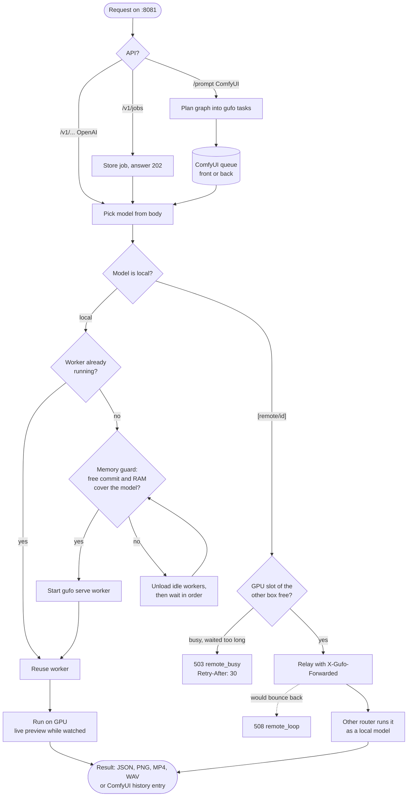
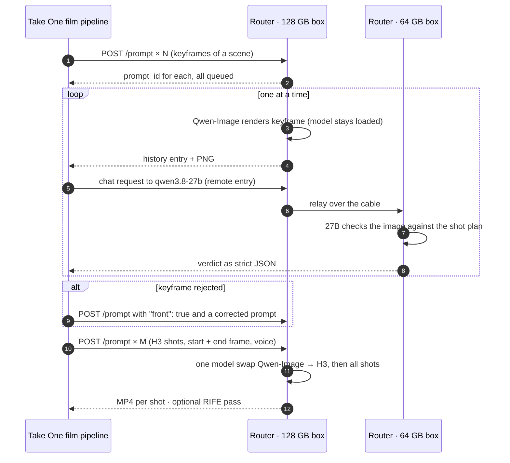

# Two machines, one AI runner

How gufo-studio-windows serves chat, images, video, speech and music from two GMKtec EVO-X2 machines
(Ryzen AI Max+ 395, Radeon 8060S / gfx1151, Windows 11, TheRock ROCm 10.0) that share the work.
Every model sits behind one port on each machine; the routers know each other and hand requests across a
direct cable.

_Written with AI assistance (Claude Code) from our configuration and test logs. Status: November 2026, build 1.2.1-fsk2._

## Schematic

Each machine runs one `gufo router`. The router owns the API surface and starts one `gufo serve` worker
process per model when a request needs it. A `[remote/<id>]` preset section makes a model on the other
machine look local (see [SERVER.md](SERVER.md#remote-models)).

| Machine | Memory | Role |
|---|---|---|
| EVO-X2 64 GB | Windows sees 32 GB, the GPU the rest | always-on checker (Qwen3.8-27B), chat, small jobs |
| EVO-X2 128 GB | Windows sees 64 GB, the GPU the rest | heavy rendering (MiniMax H3, Qwen-Image keyframes), Hemmingway-1.5 |

## What happens to one request

The same path serves an OpenAI call, a ComfyUI graph and a background job. ComfyUI graphs are first lowered
to gufo tasks (for example `SamplerCustomAdvanced` folds into a plain sampler, `LoadVideo → RIFE` becomes a
post-processing job).

## One film shot across both machines

The film pipeline sends all planned keyframes at once and collects them as they finish. While the 128 GB box
renders the next image, the 64 GB box already checks the previous one, so neither GPU waits for the other.

## Components

Everything is one executable (`gufo.exe`) with the ROCm runtime next to it. Model weights are not part of the
package; each model keeps its own licence.

- **Router:** one port per machine for every model; OpenAI, ComfyUI (`/prompt`, `/queue`, `/history`, WebSocket)
  and job APIs side by side; the memory guard checks the Windows commit limit, not only free RAM; hung workers are
  restarted and finished jobs nobody reads are released; pages for start, chat, image and status.
- **Load sharing:** `[remote/<id>]` sections plus `--remote-allow` (IPv4 / CIDR); a shared `gpu-slot` runs one
  GPU-starting request at a time; a loop-guard header answers `508` when two routers name each other; models stay
  on one machine as long as possible.
- **Text:** Qwen3.8-27B with DFlash2 speculative decoding; Hemmingway-1.5 (non-commercial licence);
  Qwen3.6-35B-A3B; Qwen3.8-Flash-Next with SSD expert streaming; Qwen3-Omni captioner for audio.
- **Image:** Qwen-Image 2.1 and Turbo (text-to-image, edit, masks, LoRA; non-commercial licence); MOSS-Image;
  live preview while a client watches.
- **Video:** MiniMax H3 (start/end frame, voice, anchor clips from the previous shot); Wan 2.2 TI2V-5B;
  Wan 2.1 Uni3C camera moves; RIFE interpolation and upscaling, also on an existing MP4.
  Experimental (built, CPU tests pass, no GPU run yet): VACE, InfiniteTalk.
- **Audio:** Qwen3-ASR with SRT / VTT subtitles; Qwen3-TTS (preset voices, voice design, cloning); ACE-Step 1.5
  music. Experimental: MMAudio foley (weights CC BY-NC 4.0, non-commercial).

## Measured on this setup

Only numbers we measured ourselves, on the hardware above.

| What | Result | Where |
|---|---|---|
| Hemmingway-1.5 decode, ~70k-token prompt, without → with DFlash2 | ~9 → 26–27 tok/s | 128 GB box, live film run |
| H3 shot, start image + voice, 512×512, 124 frames | 241 s | 128 GB box |
| H3 shot, start + end frame, 107 frames | 206 s | 128 GB box |
| H3 continuation from an anchor clip | 331 s | 128 GB box |
| RIFE ×4 on an existing clip, 124 → 493 frames | 10 s | 128 GB box |
| Load-sharing contract tests (relay, busy slot, loop, unload) | 15 / 15 pass | both boxes |
